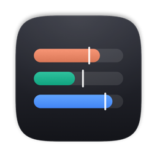
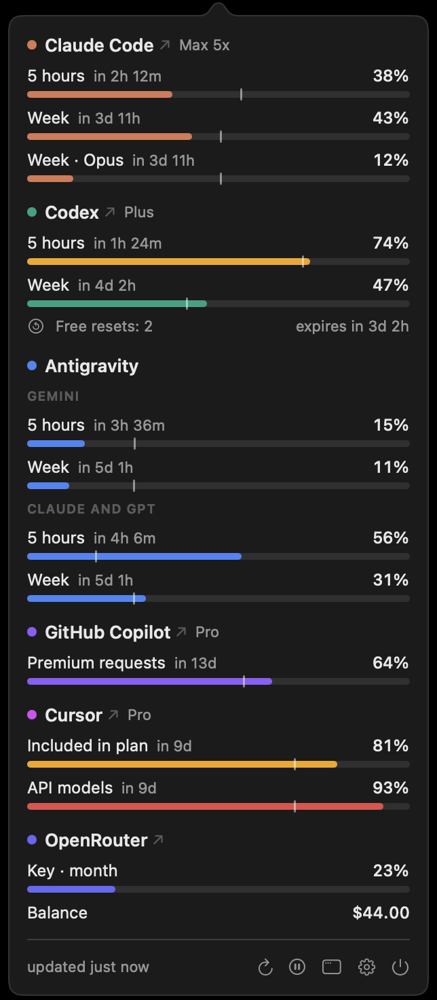
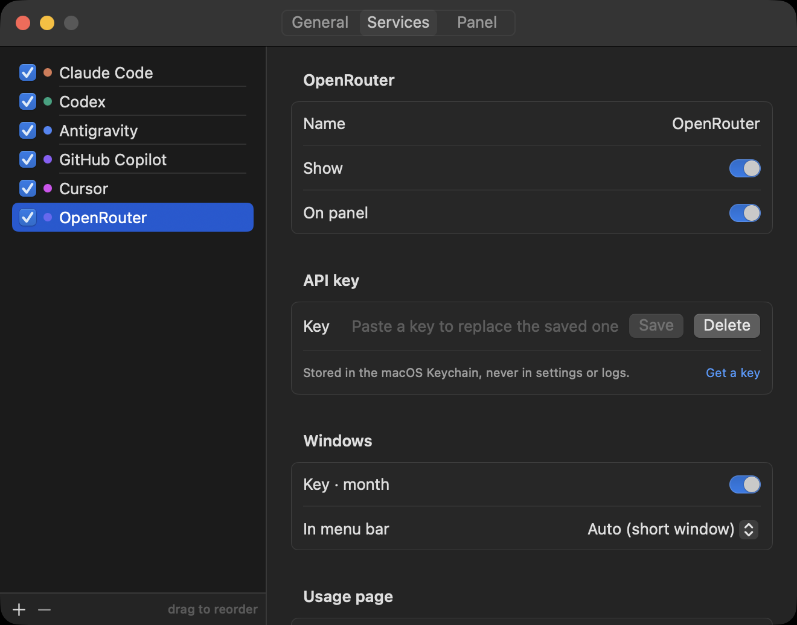

<p align="center">
  
</p>

<h1 align="center">Agents Usage</h1>

<p align="center">
  Usage limits of your AI coding subscriptions in the macOS menu bar.<br>
  Claude Code, Codex, Antigravity, GitHub Copilot, Cursor, Kimi Code, plus OpenRouter and Moonshot balances.
</p>

<p align="center">
  <a href="https://github.com/igor-batrakov/agents-usage/releases/latest"></a>
  
  <a href="https://github.com/igor-batrakov/agents-usage/actions/workflows/ci.yml"></a>
  <a href="LICENSE"></a>
</p>

<p align="center">
  <b>English</b> · <a href="README.ru.md">Русский</a>
</p>

<p align="center">
  
</p>

If you code with several AI agents, each one keeps its limits in its own place: `/usage` in Claude Code,
`/status` in Codex, a web page for Copilot. Agents Usage puts all of them in one menu bar icon. One bar per
service shows how much of the 5-hour window is used, and the color turns amber at 70% and red at 90%.

```sh
curl -fsSL https://raw.githubusercontent.com/igor-batrakov/agents-usage/main/install.sh | bash
```

## What you get

- **Menu bar icon** . A bar per service, in the order you choose. Length is the short window, color is the
  most loaded window of that service. You can switch to plain percentages or show only the worst one.
- **Popover** (click the icon or press ⌃⌥L). Every window with its percentage and the time until it resets.
  The service name opens its usage page.
- **Pace marker.** A tick on each bar shows how much of the window has already passed. If the fill is past
  the tick, you will run out before the reset.
- **Notifications** when a window reaches your threshold (90% by default) and when that window resets.
  At most one per window.
- **Desktop panel.** The same view as a floating panel above windows or pinned to the desktop, with
  corner anchoring, opacity and click-through.
- **Several accounts.** A second Claude Code or Codex account through its config directory, several API keys
  for key-based services.

## Supported services

| Service | What it shows | Where the sign-in comes from |
|---|---|---|
| Claude Code | 5 hours, week, week per model | Claude Code login in the Keychain |
| Codex | 5 hours, week, free resets | `codex app-server` (Codex keeps its own login) |
| Antigravity | Gemini, Claude and GPT model groups | `agy` CLI |
| GitHub Copilot | Monthly chat, completions and premium requests | GitHub CLI (`gh auth login`) |
| Cursor | Included usage, Auto, API models, on-demand | Cursor app (read-only) |
| Kimi Code | 5 hours, week or month | API key from the Kimi console |
| OpenRouter | Key budget and account balance | API key |
| Moonshot | Platform balance in USD or CNY | API key |

None of these APIs are public. If a vendor changes its format, that service shows an error and the rest keep
working.

## Install

### One command (recommended)

```sh
curl -fsSL https://raw.githubusercontent.com/igor-batrakov/agents-usage/main/install.sh | bash
```

The script downloads the latest release into `~/Applications` and starts the app. Files fetched by `curl`
are not marked as downloaded from the internet, so macOS starts the app without the "unidentified developer"
dialog. Read the script before running it: [install.sh](install.sh).

### Download

Get `Agents-Usage.dmg` or `Agents-Usage.zip` from the [latest release](https://github.com/igor-batrakov/agents-usage/releases/latest)
and drag the app to Applications. The app is not signed with an Apple Developer ID, so the first launch is
blocked. To allow it:

1. Open the app once and close the warning.
2. Open **System Settings → Privacy & Security**, scroll down and click **Open Anyway**.

Or, in Terminal: `xattr -dr com.apple.quarantine "/Applications/Agents Usage.app"`.

### Build from source

You need macOS 15 or later and the Command Line Tools (`xcode-select --install`). Xcode is not required.

```sh
git clone https://github.com/igor-batrakov/agents-usage.git
cd agents-usage
./build.sh install
```

### Updates

Once a day the app checks GitHub for a new release. When there is one, the popover shows a line with an
**Update** button: it downloads that release with the copy of `install.sh` inside the app, replaces the app
where it is and restarts it. If the app was renamed or sits in a folder you can't write to, the button opens
the release page instead. Settings → About has a manual check and a switch to turn the daily check off.

## Privacy and security

- The app uses the logins you already have and never refreshes tokens itself. Refresh tokens are single-use,
  so refreshing one behind a CLI's back would sign that CLI out.
- API keys go to the macOS Keychain. They are never written to settings or logs.
- Requests go only to the vendors' own APIs, plus one request a day to GitHub for the latest release number
  (you can turn it off). There is no analytics and no server of ours.
- Between polls the app does nothing. Typical footprint is about 18 MB of memory and 0% CPU.

## Settings

<p align="center">
  
</p>

- **General.** Refresh interval (1, 5, 15 or 30 minutes), energy saver, notification threshold, menu bar style,
  pace marker, language, launch at login, hotkey.
- **Services.** Add, remove and reorder services, hide windows you don't need, pick the window for the menu bar,
  paste API keys, set a custom usage page.
- **Panel.** Mode, corner and margin, opacity, click-through, which services to show.
- **About.** Version, update check, links to the project.

## Languages

The interface is available in English and Russian and follows the system language by default. You can pick
another one in **Settings → General → Language** without restarting.

Adding a language takes one file and no code. See [CONTRIBUTING.md](CONTRIBUTING.md#translations).

## FAQ

**Why isn't the app signed?** A Developer ID costs $99 a year. Use the install script or build from source to
skip the warning.

**The first launch takes a while.** macOS scans a new app before its first run. It happens once per version.

**A service shows "token expired".** Run that CLI once (for example `claude`), it refreshes its own token, and
the next poll picks it up.

## Contributing

Bug reports, new services and translations are welcome. Start with [CONTRIBUTING.md](CONTRIBUTING.md).

## License

[MIT](LICENSE) © 2026 Igor Batrakov
