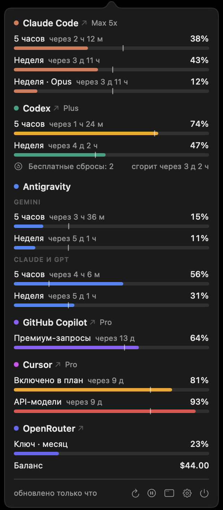
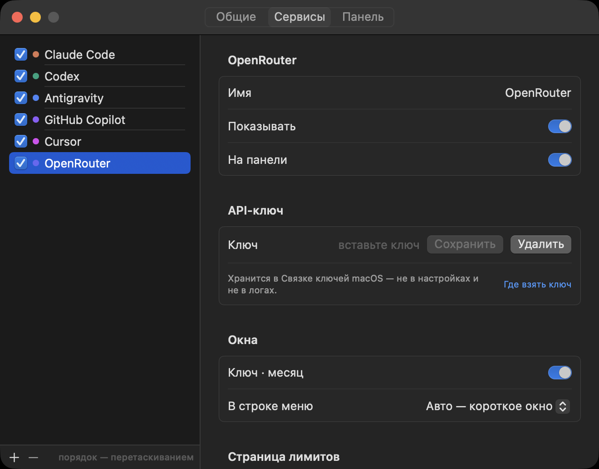

<p align="center">
  
</p>

<h1 align="center">Agents Usage</h1>

<p align="center">
  Лимиты подписок на ИИ-агентов в строке меню macOS.<br>
  Claude Code, Codex, Antigravity, GitHub Copilot, Cursor, Kimi Code, балансы OpenRouter и Moonshot.
</p>

<p align="center">
  <a href="https://github.com/igor-batrakov/agents-usage/releases/latest"></a>
  
  <a href="https://github.com/igor-batrakov/agents-usage/actions/workflows/ci.yml"></a>
  <a href="LICENSE"></a>
</p>

<p align="center">
  <a href="README.md">English</a> · <b>Русский</b>
</p>

<p align="center">
  
</p>

Если вы работаете с несколькими ИИ-агентами, лимиты каждого живут в своём месте: `/usage` в Claude Code,
`/status` в Codex, веб-страница у Copilot. Agents Usage собирает их в одну иконку в строке меню. По полоске
на сервис: длина — сколько израсходовано из 5-часового окна, цвет становится янтарным с 70% и красным с 90%.

```sh
curl -fsSL https://raw.githubusercontent.com/igor-batrakov/agents-usage/main/install.sh | bash
```

## Что умеет

- **Иконка в строке меню** . По полоске на сервис в выбранном вами порядке. Длина — короткое окно, цвет — самое
  нагруженное окно сервиса. Вместо полосок можно показывать проценты или только самый нагруженный сервис.
- **Поповер** по клику на иконку или по ⌃⌥L. Все окна лимитов: процент и время до сброса. Имя сервиса
  открывает его страницу лимитов.
- **Метка темпа.** Чёрточка на полоске показывает, сколько времени окна уже прошло. Если заливка правее
  чёрточки, лимит кончится раньше сброса.
- **Уведомления**, когда окно дошло до порога (по умолчанию 90%) и когда это окно сбросилось. Не чаще раза
  за окно.
- **Панель на рабочем столе.** То же, что в поповере, отдельной панелью поверх окон или на обоях: привязка
  к углу, прозрачность, режим «сквозь клики».
- **Несколько аккаунтов.** Второй аккаунт Claude Code или Codex — через его каталог конфигурации, у сервисов
  с API-ключом — по ключу на аккаунт.

## Сервисы

| Сервис | Что показывает | Откуда вход |
|---|---|---|
| Claude Code | 5 часов, неделя, неделя по модели | вход Claude Code в Связке ключей |
| Codex | 5 часов, неделя, бесплатные сбросы | `codex app-server` (вход держит сам Codex) |
| Antigravity | группы моделей Gemini, Claude и GPT | CLI `agy` |
| GitHub Copilot | месячные квоты: чат, автодополнения, премиум-запросы | GitHub CLI (`gh auth login`) |
| Cursor | включённое в план, Auto, API-модели, сверх плана | приложение Cursor (только чтение) |
| Kimi Code | 5 часов, неделя или месяц | API-ключ из консоли Kimi |
| OpenRouter | бюджет ключа и баланс счёта | API-ключ |
| Moonshot | баланс платформы в долларах или юанях | API-ключ |

API этих сервисов не публичные. Если вендор поменяет формат ответа, в его блоке появится ошибка, остальные
продолжат работать.

## Установка

### Одной командой

```sh
curl -fsSL https://raw.githubusercontent.com/igor-batrakov/agents-usage/main/install.sh | bash
```

Скрипт скачивает последний релиз в `~/Applications` и запускает приложение. Файлы, скачанные через `curl`,
macOS не помечает как загруженные из интернета, поэтому предупреждения о неустановленном разработчике не будет.
Перед запуском скрипт можно прочитать: [install.sh](install.sh).

### Скачать вручную

Скачайте `Agents-Usage.dmg` или `Agents-Usage.zip` из [последнего релиза](https://github.com/igor-batrakov/agents-usage/releases/latest)
и перетащите приложение в «Программы». У приложения нет подписи Apple Developer ID, поэтому первый запуск
macOS заблокирует. Чтобы разрешить:

1. Откройте приложение и закройте предупреждение.
2. Откройте **Системные настройки → Конфиденциальность и безопасность**, внизу нажмите **Всё равно открыть**.

Или в Терминале: `xattr -dr com.apple.quarantine "/Applications/Agents Usage.app"`.

### Собрать из исходников

Нужны macOS 15 или новее и Command Line Tools (`xcode-select --install`). Xcode не нужен.

```sh
git clone https://github.com/igor-batrakov/agents-usage.git
cd agents-usage
./build.sh install
```

## Приватность и безопасность

- Приложение пользуется входом, который у вас уже есть. Токены оно само не обновляет: refresh-токены
  одноразовые, и обновление за спиной CLI разлогинило бы его.
- API-ключи хранятся в Связке ключей macOS. В настройки и логи они не попадают.
- Запросы уходят только в API самих вендоров. Аналитики и своего сервера нет.
- Между опросами приложение ничего не делает: около 18 МБ памяти и 0% процессора.

## Настройки

<p align="center">
  
</p>

- **Общие.** Интервал обновления (1, 5, 15 или 30 минут), экономный опрос, порог уведомлений, вид иконки,
  метка темпа, язык, автозапуск, горячая клавиша.
- **Сервисы.** Добавить, удалить и упорядочить сервисы, скрыть ненужные окна, выбрать окно для строки меню,
  вставить API-ключ, задать свою страницу лимитов.
- **Панель.** Режим, угол и отступ, прозрачность, «сквозь клики», какие сервисы показывать.

## Языки

Интерфейс есть на английском и русском, по умолчанию — на языке системы. Другой язык выбирается в
**Настройки → Общие → Язык**, перезапуск не нужен.

Новый язык — это один файл, код менять не нужно. Как добавить — в [CONTRIBUTING.md](CONTRIBUTING.md#translations).

## Вопросы

**Почему приложение не подписано?** Подпись Apple Developer ID стоит $99 в год. Чтобы обойтись без
предупреждения, ставьте скриптом или соберите из исходников.

**Первый запуск идёт долго.** Перед первым запуском новой версии macOS проверяет приложение. Это бывает один раз.

**У сервиса «токен истёк».** Запустите его CLI один раз (например, `claude`): он сам обновит токен, и
следующий опрос подхватит данные.

## Участие

Сообщения об ошибках, новые сервисы и переводы — всё пригодится. Начните с [CONTRIBUTING.md](CONTRIBUTING.md).

## Лицензия

[MIT](LICENSE) © 2026 Игорь Батраков
